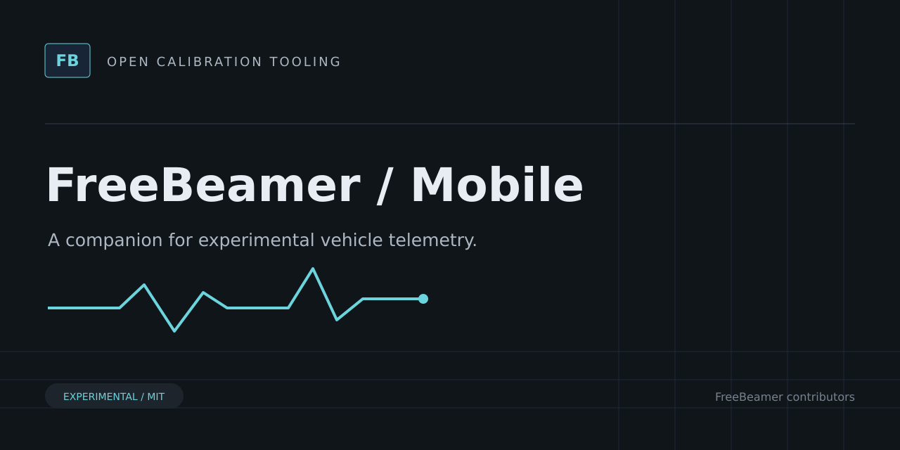

# FreeBeamer Mobile



Experimental Flutter companion for read-only MHD/ENET live-data acquisition and upload to a FreeBeamer telemetry relay.

> [!WARNING]
> Experimental software. Not validated for vehicle use. Do not flash files produced by FreeBeamer.

Flutter companion for read-only acquisition, local buffering, QR/deep-link device pairing, and relay upload. Physical vehicle compatibility is unverified; iOS has not been built or validated.

See [mobile setup and implementation notes](docs/mobile-development.md), including iOS platform generation. The Android platform folder is committed.

## Development

```sh
flutter pub get
flutter analyze
flutter test
```

## Related projects

- [Core](https://github.com/freebeamer/core) — Go libraries for ECU calibration formats, binary editing, checksums, vehicle profiles, and telemetry contracts.
- [CLI](https://github.com/freebeamer/cli) — Command-line tools for inspecting calibration files, reviewing binary changes, verifying checksums, and collecting experimental live data.
- [Desktop](https://github.com/freebeamer/desktop) — Experimental ECU calibration editor and live-data viewer built with Go, Wails, Angular, and Plotly.
- [Relay](https://github.com/freebeamer/relay) — Self-hosted Go telemetry relay with authenticated ingestion, SQLite storage, session history, and WebSocket live feeds.

## Contributing and license

See [CONTRIBUTING.md](CONTRIBUTING.md). Source and original artwork are licensed under [MIT](LICENSE). Do not submit proprietary firmware, customer files, secrets, or identifying vehicle data.
